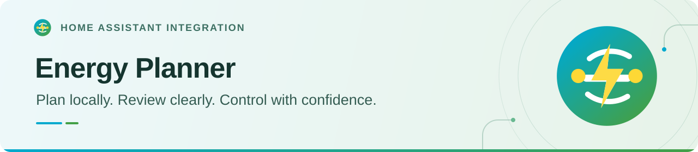
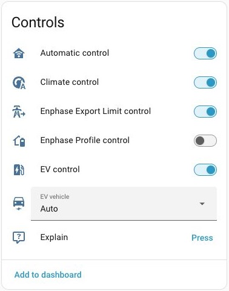
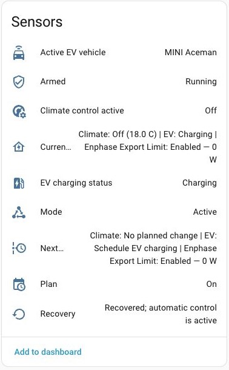
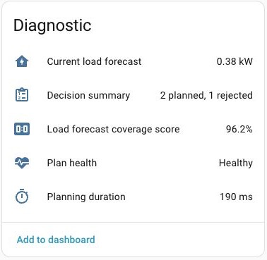
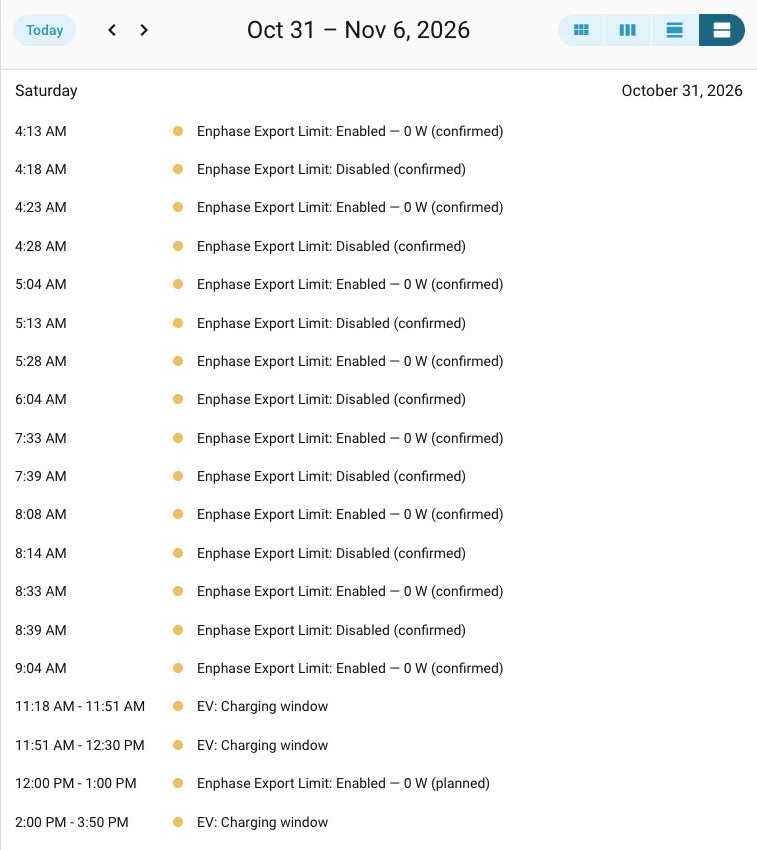

<picture>
  <source media="(prefers-color-scheme: dark)" srcset="docs/images/readme-banner-dark.svg">
  <source media="(prefers-color-scheme: light)" srcset="docs/images/readme-banner-light.svg">
  
</picture>

  
  
  

Coordinate EV charging, climate comfort and Enphase controls with your home's energy plan.

  <a href="#get-started">Install</a> ·
  <a href="#key-features">Features</a> ·
  <a href="#at-a-glance">Screenshots</a> ·
  <a href="https://github.com/barneyonline/ha-energy-planner/wiki">Documentation</a>

Local-first planning through your existing Home Assistant entities and actions.

## Key features

- **EV charging:** Tariff-aware schedules, ready-by targets and vehicle profiles for a shared charger.
- **Climate comfort:** Preconditioning with room feedback, learned thermal rates and guarded restoration.
- **Enphase controls:** Operating profiles and independent Export Limit control where supported.
- **Load forecasting:** Recorder-trained household demand alongside solar, tariffs and battery reserves.
- **Review and control:** Current state, next actions, a plan calendar and per-area Automatic control.
- **Diagnostics and explanations:** Redacted diagnostics and optional, on-demand AI advice.

## At a glance

Choose which areas the planner manages, then review its state and next actions.

<!-- Inline images wrap on narrow screens. Keep their natural proportions. -->

  <picture>
    <source media="(prefers-color-scheme: dark)" srcset="docs/images/planner-controls-dark.jpg">
    <source media="(prefers-color-scheme: light)" srcset="docs/images/planner-controls-light.jpg">
    
  </picture>
  &nbsp;
  <picture>
    <source media="(prefers-color-scheme: dark)" srcset="docs/images/planner-sensors-dark.jpg">
    <source media="(prefers-color-scheme: light)" srcset="docs/images/planner-sensors-light.jpg">
    
  </picture>

*Examples from a configured installation; live settings and readings are not first-run defaults.*

More screenshots · diagnostics, plan calendar and history

### Forecast and plan health

  <picture>
    <source media="(prefers-color-scheme: dark)" srcset="docs/images/planner-diagnostics-dark.jpg">
    <source media="(prefers-color-scheme: light)" srcset="docs/images/planner-diagnostics-light.jpg">
    
  </picture>

### Plan calendar

<picture>
  <source media="(prefers-color-scheme: dark)" srcset="docs/images/plan-calendar-dark.jpg">
  <source media="(prefers-color-scheme: light)" srcset="docs/images/plan-calendar-light.jpg">
  
</picture>

The calendar distinguishes upcoming plan windows from retained confirmed activity. See [Plan Calendar](https://github.com/barneyonline/ha-energy-planner/wiki/Plan-Calendar).

## Get started

1. [Open Energy Planner in HACS](https://my.home-assistant.io/redirect/hacs_repository/?owner=barneyonline&repository=ha-energy-planner&category=integration), add the repository if prompted, and download it.
2. Restart Home Assistant, then add **Energy Planner** under **Settings → Devices & services → Add integration**.
3. Map your inputs in **Configure → Planner settings**. Keep **Automatic control** off while reviewing plans and the safety check.

Enter your Home Assistant URL if prompted by the HACS link. [Manual installation and removal](https://github.com/barneyonline/ha-energy-planner/wiki/Installation).

Requires **Home Assistant 2026.10.0+** (Python **3.14+**). Normal planning needs tariff and solar forecasts, household consumption with Recorder history, and battery SOC. [Export-only operation](https://github.com/barneyonline/ha-energy-planner/wiki/Enphase-Export-Limit) has narrower requirements.

**Automatic control** records your request to operate; **Armed** reports actual command authority.

## Documentation

[Setup](https://github.com/barneyonline/ha-energy-planner/wiki/Hub-and-Input-Setup) · [Safety and production](https://github.com/barneyonline/ha-energy-planner/wiki/Safety-and-Production) · [Troubleshooting](https://github.com/barneyonline/ha-energy-planner/wiki/Troubleshooting) · [Known limitations](https://github.com/barneyonline/ha-energy-planner/wiki/Known-Limitations)

The [planning and control guide](docs/planning-and-control.md) preserves the detailed operating notes, compatibility requirements and safety limits.

Planning and control details

- [Supported control areas](docs/planning-and-control.md#supported-control-areas) and [compatibility](docs/planning-and-control.md#compatibility)
- [EV scheduling, suspension, daylight preference and cost checks](docs/ev-scheduling.md)
- [Climate demand, thermal learning, independent zones and equipment compensation](docs/climate-decisions.md)
- [HVAC restoration and recovery](docs/hvac-restoration-recovery.md)
- [Export Limit timing and confirmed readback](docs/export-limit-timing.md)
- [Load forecasting, tariffs, solar and battery reserves](https://github.com/barneyonline/ha-energy-planner/wiki/Energy-Planning)
- [Calendar timing, planned windows and confirmed history](https://github.com/barneyonline/ha-energy-planner/wiki/Plan-Calendar)

Configured through the Home Assistant UI. No separate vendor credentials or third-party Python dependencies are required. AI explanations are advisory; selected planner context goes to your configured provider only when requested.

[Releases](https://github.com/barneyonline/ha-energy-planner/releases) · [Changelog](CHANGELOG.md) · [Issues](https://github.com/barneyonline/ha-energy-planner/issues) · [Development](https://github.com/barneyonline/ha-energy-planner/wiki/Development) · [Requirements evidence](docs/requirements-audit.md) · [Quality-scale evidence](quality_scale.yaml) · [Validation warnings](docs/validation-warnings.md)

The Platinum quality-scale claim is a repository self-assessment. This custom integration is not reviewed, security audited, maintained or supported by the Home Assistant project.

---

